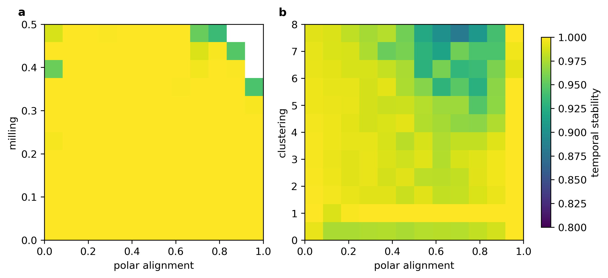

# Self-propelled particle behavioral repertoire

Python implementation and reproducibility package for **Evolutionary Discovery of the Behavioral Repertoire of Self-Propelled Particle Models**, Roujia Wen and Eric Bonabeau (2026).

This repository explores how local interaction rules generate collective motion. It simulates particles that align, repel, attract, and respond to angular noise, then searches parameter space for flocks, mills, clusters, and other collective states. Quality-diversity optimization organizes these behaviors into archives, while learned trajectory representations and local sensitivity measurements reveal how behavior changes across parameter space. A two-species model supports matched tests of reciprocal and non-reciprocal interactions.

The package includes single- and two-species dynamics, reflecting and periodic boundaries, classical collective-state measures, MAP-Elites and CMA-MAE, differential evolution, trajectory descriptors, autoencoders, local sensitivity and ridge tracing, reciprocal controls, finite-size analyses, and figure-generation code. Saved numerical results and model checkpoints are included.



## Model

Particle $i$ has position $\mathbf{x}_i(t)$ and unit heading
$\mathbf{u}_i(t)=(\cos\theta_i(t),\sin\theta_i(t))$. At each synchronous step,
the deterministic drive combines heading persistence, local alignment, an
optional taxis cue, and pair interactions:

```math
\mathbf{d}_i(t) = \epsilon\,\mathbf{u}_i(t) + \alpha\,\mathbf{a}_i(t) + \gamma\,\mathbf{G} + f_0\,\mathbf{F}_i(t).
```

Independent angular noise is added to the drive direction. Before boundary
handling and overlap correction, the update is

```math
\begin{aligned} \theta_i(t+1) &= \arg\!\left(\mathbf{d}_i(t)\right)+\eta\,\xi_i(t), \\ \xi_i(t) &\sim\mathcal{U}[-\pi,\pi],\\ \mathbf{x}_i(t+1) &= \mathbf{x}_i(t)+v_0\,\Delta t\,\mathbf{u}_i(t+1). \end{aligned}
```

The paper uses $\Delta t=1$ and $\gamma=0$. If the drive vanishes, the
implementation retains the previous heading before adding noise. Alignment
uses the normalized sum of neighboring headings, including the focal particle.
With $\widehat{\mathbf{r}}_{ij}$ pointing from particle $i$ to particle $j$,
the radial force is

```math
\mathbf{F}_i = \sum_{j\ne i} f(r_{ij})\,\widehat{\mathbf{r}}_{ij},
```

with the piecewise interaction strength

```math
f(r) = \begin{cases} -F_{\mathrm{core}}, & r\le 2r_0,\\ (\beta+1)\dfrac{r-2r_0}{r_1-2r_0}-1, & 2r_0\lt r\lt r_1,\\ 0, & r\ge r_1. \end{cases}
```

The attraction parameter is

```math
\beta = \exp\!\left[\tan\!\left(\frac{\pi B}{2}\right)\right].
```

The numerical hard-core strength is $F_{\mathrm{core}}=50$ by default.
Three overlap-projection passes follow each update; the saved diagnostics
report any remaining overlaps. The nine active single-species controls are
$\rho$, $v_0$, $\epsilon$, $r_1/r_0$, $f_0$, $B$, $r_a/r_0$, $\alpha$, and $\eta$.

In the two-species extension, the alignment weights and additive radial
couplings are

```math
J= \begin{pmatrix} 1 & J_s+J_a\\ J_s-J_a & 1 \end{pmatrix}, \qquad C= \begin{pmatrix} 0 & C_s+C_a\\ C_s-C_a & 0 \end{pmatrix}.
```

Together with the species-B fraction $f_B$, these add five controls.
The matched reciprocal control sets $J_a=C_a=0$. Measurements include polar
alignment $\phi$, milling $m$, clustering $\Gamma$, nematic order $S_2$,
sixfold bond order $\psi_6$, drift, and chirality. The learned descriptors
contain 51 single-species or 107 two-species features.

See [numerical conventions](docs/NUMERICS.md) for normalization, geometry,
sampling, and the scope of numerical replay. Mathematical expressions use
[GitHub's supported math formatting](https://docs.github.com/en/get-started/writing-on-github/working-with-advanced-formatting/writing-mathematical-expressions).

## Install

Use Python 3.10 or newer; Python 3.12 is the tested release environment. Run commands from this directory.

```bash
git clone https://github.com/bonabeau-gif/spp-physica-a.git
cd spp-physica-a
python -m venv .venv
source .venv/bin/activate
python -m pip install -e ".[analysis,dev]"
python -m pytest -q
```

On Windows, activate with `.venv\Scripts\activate`. For simulations alone, install with `python -m pip install -e .`.

## Run a simulation

```bash
spp-physica-a simulate --config configs/single_demo.json --output outputs/single
spp-physica-a simulate --config configs/two_species_demo.json --output outputs/two
```

Each run saves its complete configuration, seed, scalar measurements, and overlap diagnostics in `run.json`, plus positions, headings, species labels, time series, recording times, and trajectory descriptors in `trajectory.npz`. Choose a new output directory for each run.

```python
from spp_unified import SingleParams, SimulationConfig, simulate_single

params = SingleParams(rho=0.10, noise=0.10)
config = SimulationConfig(steps=160, sample_start=80, seed=42)
result = simulate_single(params, config, record_states=True, state_every=8)
print(result.summary)
```

## Reproduce the analyses

[The reproduction guide](docs/REPRODUCING.md) maps manuscript sections to experiment drivers, inputs, outputs, and computational budgets. [Numerical conventions](docs/NUMERICS.md) describe the implementation and the scope of numerical replay.

```bash
# Replot the numbered figures; some panels regenerate representative trajectories.
python scripts/reproduce_figures.py

# Independent 72-rule test, four model initializations, and mixture split audit.
python experiments/independent_validation.py --workers 4

# Full classical archives: 64,000 simulator evaluations per archive.
python experiments/parallel_archives.py --workers 4
```

The four full archives require 256,000 simulations in total. Their saved outputs are included, so plotting and downstream analyses can run without repeating the searches. Experiment drivers write to `results/` and `figures/`; run expensive campaigns in a separate checkout to retain the supplied results. The simulation CLI and independent-audit driver default to separate output locations.

## Contents

| Directory | Contents |
|---|---|
| `spp_unified/` | Installable simulation, descriptor, optimization, and analysis API |
| `boundary/` | Sensitivity estimation, continuation, controls, and caching |
| `experiments/` | Simulation campaigns and analysis drivers |
| `configs/`, `examples/` | Runnable configurations and API example |
| `results/` | Search archives, tables, descriptors, trained weights, and fresh audit |
| `figures/manuscript/` | All 11 main and 19 supplementary figures from the supplied manuscripts |
| `scripts/` | Numbered figure generation and release integrity checks |
| `tests/` | Numerical, determinism, descriptor, search, and packaging checks |
| `docs/` | Reproduction instructions, numerical conventions, and figure provenance |

The GitHub checkout contains the complete research bundle. The wheel provides the Python API; use the checkout for the experiment drivers and saved datasets. GitHub Actions tests installation and the numerical suite on Linux, macOS, and Windows.

Use `CITATION.cff` to cite this work. Public reuse permissions are stated in `LICENSE`.
